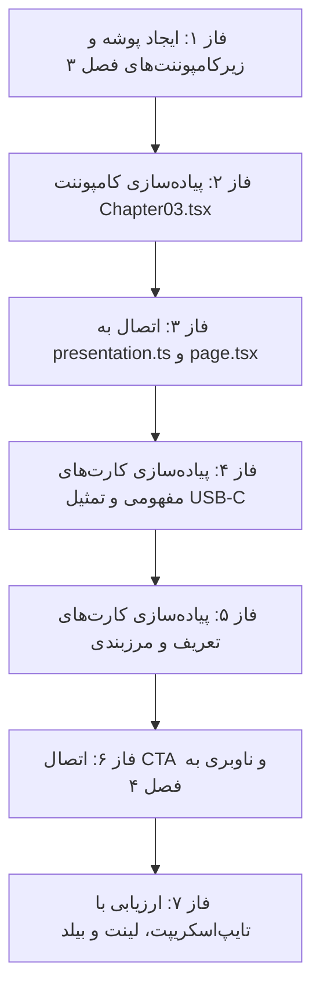

# برنامه جامع پیاده‌سازی فنی فصل سوم (CHAPTER 03 IMPLEMENTATION PLAN)
## «معرفی Model Context Protocol (MCP): از اتصال‌های اختصاصی تا یک استاندارد مشترک»

**پروژه:** ارائه تعاملی و دانشگاهی Model Context Protocol (MCP)  
**فصل:** 03 — Introduction to Model Context Protocol  
**نوع سند:** مستندات برنامه‌ریزی و نقشه‌راه فنی پیاده‌سازی (Implementation Roadmap)  
**مخزن:** `D:\web-img\React\mcp-presentation`  
**وضعیت:** مصوب برای فاز کدنویسی بعدی (Ready for Next Task Implementation)

---

## ۱. یافته‌های معماری موجود و محدودیت‌های سیستم (System Architecture Findings)

بازرسی جامع مخزن، مشخصات فنی زیر را مشخص کرده است:

1. **فریم‌ورک و هسته اجرا:**
   * Next.js 16.4.6 با معماری جدید App Router و کامپایلر Turbopack.
   * React 19.3.0 با پشتیبانی کامل از Server Actions و استریم کامپوننت‌ها.
   * TypeScript 5 در حالت اکید (`strict: true`).
   * Tailwind CSS نسخه v4.3.3 با استفاده از توکن‌های مدرن `@theme`.
2. **پوسته ارائه و ناوبری دوگانه:**
   * **Presentation Mode:** حالت ارائه‌ای اسلاید-محور تمام‌صفحه با دکمه‌های کنترلی شناور (`PresentationControls`)، نشانگر پیشرفت گام‌به‌گام و هدایت با کیبورد (`ArrowLeft` برای اسلاید بعد و `ArrowRight` برای اسلاید قبل در چیدمان RTL فارسی).
   * **Scroll Mode:** حالت روایتی سینمایی برای اسکرول پیوسته عمودی در قالب بخش‌های مدون (`ChapterSection`) همراه با نوار پیشرفت بالای صفحه (`ScrollProgress`).
3. **وضعیت کنونی فصل سوم در کد:**
   * فایل `src/components/chapters/Chapter03.tsx` و پوشه `src/components/chapters/chapter03/` در مخزن وجود ندارند.
   * در فایل `src/lib/presentation.ts`، متادیتای فصل ۳ ثبت شده اما آرایه `slides: []` آن خالی است.
   * در `src/app/presentation/page.tsx`، شرط `currentChapterId === 3` به یک صفحه نگه‌دارنده موقت (Fallback) منتهی می‌شود.
4. **دستورالعمل حیاتی پرهیز از 3D غیرضروری:**
   * جلوه‌های سه‌بعدی سنگین فقط برای صحنه آغازین هیرو (Chapter 01 Hero) در نظر گرفته شده‌اند.
   * فصل سوم باید منحصراً بر نمودارهای ساختاریافته دو بعدی (2D Vector Schematics)، کارت‌های مفهومی تمیز و ترنزیشن‌های نرم فریم‌ورک `motion/react` متمرکز باشد.

---

## ۲. معماری کامپوننت‌های فصل سوم (Component Architecture)

معماری پیشنهادی شامل یک کامپوننت والد هماهنگ‌کننده (`Chapter03.tsx`) و ۶ زیرکامپوننت تخصصی برای بخش‌های شش‌گانه است:

```
src/components/chapters/
├── Chapter03.tsx                                  # هماهنگ‌کننده اصلی اسلایدها و حالت اسکرول
└── chapter03/
    ├── BespokeIntegrationSection.tsx             # بخش ۳.۱: چالش اتصالات نقطه‌به‌نقطه M×N
    ├── SharedStandardSection.tsx                 # بخش ۳.۲: ایده استاندارد مشترک و قرارداد واحد M+N
    ├── UsbCAnalogySection.tsx                    # بخش ۳.۳: تمثیل درگاه USB-C، فرصت‌ها و مرزها
    ├── McpDefinitionSection.tsx                  # بخش ۳.۴: تعریف رسمی MCP و پیش‌نمایش ۳ قابلیت
    ├── WhatMcpIsNotSection.tsx                   # بخش ۳.۵: مرزبندی دقیق و ابطال ۵ سوءبرداشت
    └── Chapter03Conclusion.tsx                   # بخش ۳.۶: پل انتقال و CTA ورود به فصل چهارم
```

---

## ۳. کالبدشکافی مسئولیت و اینترفیس کامپوننت‌ها (Component Specifications)

### ۱) کامپوننت هماهنگ‌کننده: `Chapter03.tsx`
* **مسیر فایل:** `src/components/chapters/Chapter03.tsx`
* **نوع کامپوننت:** Client Component (`'use client'`)
* **اینترفیس ورودی (Props):**
  ```typescript
  interface Chapter03Props {
    mode?: 'scroll' | 'slides';
    activeSlideIndex?: number;
    onSelectChapter?: (chapterId: number) => void;
  }
  ```
* **مسئولیت‌ها:**
  * در حالت `slides`: رندر اسلاید فعال بر اساس `activeSlideIndex` (بین ۰ تا ۵) با انیمیشن روان `AnimatePresence mode="wait"`.
  * در حالت `scroll`: رندر متوالی هر ۶ بخش در یک چیدمان منظم با فاصله عمودی استاندارد (`space-y-24`).
  * مدیریت ارسال رویدادهای ناوبری و هدایت به فصل ۴ از طریق `onSelectChapter(4)`.

---

### ۲) بخش ۳.۱: `BespokeIntegrationSection.tsx`
* **مسیر فایل:** `src/components/chapters/chapter03/BespokeIntegrationSection.tsx`
* **مسئولیت‌ها:**
  * نمایش چالش اتصالات نقطه‌به‌نقطه اختصاصی میان ۳ کلاینت و ۴ سرویس خارجی.
  * نمایش فرمول مفهومی $M \times N = 12$ به همراه یادداشت هشدار پیرامون هزینه تغییرات API.
  * رندر سه نقطه آسیب (تکرار کد، قفل‌شدگی به ارائه‌دهنده، بار نگهداری فرساینده).
* **مولفه‌های مورد استفاده:** `Card`, `Badge`, آیکون‌های Lucide (`Unplug`, `AlertTriangle`, `Layers`).

---

### ۳) بخش ۳.۲: `SharedStandardSection.tsx`
* **مسیر فایل:** `src/components/chapters/chapter03/SharedStandardSection.tsx`
* **مسئولیت‌ها:**
  * ارائه مفهوم «قرارداد مشترک» و یادآوری نمونه‌های تاریخی نظیر HTTP برای وب و SQL برای پایگاه‌های داده.
  * دیاگرام دوسطحی مقایسه «قبل و بعد»: گذار از آشفتگی اتصالات دوجانبه به گذرگاه پروتکل باز مشترک ($M + N$).
  * درج یادداشت تدقیق علمی: استاندارد پیچیدگی نگهداری و احراز هویت را صفر نمی‌کند، بلکه زبان مشترک کشف و تعامل می‌سازد.
* **مولفه‌های مورد استفاده:** `Card`, `Badge`, آیکون‌های Lucide (`Share2`, `CheckCircle2`, `ArrowRightLeft`).

---

### ۴) بخش ۳.۳: `UsbCAnalogySection.tsx`
* **مسیر فایل:** `src/components/chapters/chapter03/UsbCAnalogySection.tsx`
* **مسئولیت‌ها:**
  * تجسم دووجهی استعاره درگاه USB-C برای هوش مصنوعی.
  * ستون اول: نقاط قوت تمثیل (اتصال عمومی، تعویض‌پذیری ابزارها، استقلال از برندها).
  * ستون دوم: مرزهای علمی و تفاوت‌ها (پروتکل نرم‌افزاری در برابر کابل، مذاکره بر سر قابلیت‌ها، امنیت و مجوزهای غیرجادویی).
  * بخش تعاملی بازشونده کوچک جهت مطالعه تحلیلی عمیق‌تر.
* **مولفه‌های مورد استفاده:** `Card`, `Badge`, `Button`, آیکون‌های Lucide (`Usb`, `Cpu`, `ShieldCheck`, `HelpCircle`).

---

### ۵) بخش ۳.۴: `McpDefinitionSection.tsx`
* **مسیر فایل:** `src/components/chapters/chapter03/McpDefinitionSection.tsx`
* **مسئولیت‌ها:**
  * کادر برجسته متن تعریف رسمی و مصوب پروتکل بافتار مدل (MCP).
  * متادیتای خاستگاه پروتکل (معرفی توسط Anthropic در نوامبر ۲۰۲۴ و اهدای رسمی به بنیاد AAIF ذیل Linux Foundation در دسامبر ۲۰۲۵).
  * ۳ کارت متقارن پیش‌نمایش ۳ قابلیت بنیادین سرور: ابزارها (`Tools` - فیروزه‌ای)، منابع داده (`Resources` - نیلی) و پرامپت‌ها (`Prompts` - کهربایی).
* **مولفه‌های مورد استفاده:** `Card`, `Badge`, آیکون‌های Lucide (`Wrench`, `Database`, `Sparkles`, `Globe`).

---

### ۶) بخش ۳.۵: `WhatMcpIsNotSection.tsx`
* **مسیر فایل:** `src/components/chapters/chapter03/WhatMcpIsNotSection.tsx`
* **مسئولیت‌ها:**
  * ابطال ۵ سوءبرداشت رایج فنی در کارت‌های تفکیک‌شده:
    1. مدل زبانی (LLM) نیست.
    2. خودِ فراخوانی ابزار (Tool Calling) نیست.
    3. پایگاه داده (Database) نیست.
    4. موتور اجرای مستقل (Execution Runtime) نیست.
    5. سپر امنیتی خودکار (Automatic Security Shield) نیست.
  * برجسته‌سازی کارت تفاوت Tool Calling و MCP با استایل شاخص و نشان دادن رابطه هم‌افزا.
* **مولفه‌های مورد استفاده:** `Card`, `Badge`, آیکون‌های Lucide (`XCircle`, `Brain`, `Terminal`, `ShieldAlert`, `Server`).

---

### ۷) بخش ۳.۶: `Chapter03Conclusion.tsx`
* **مسیر فایل:** `src/components/chapters/chapter03/Chapter03Conclusion.tsx`
* **مسئولیت‌ها:**
  * ایجاد زمینه پرسشگری برای نحوه پیاده‌سازی و ساختار داخلی پروتکل.
  * طرح پیش‌نمایش شماتیک از بازیگران سه‌گانه (`Host`، `Client`، `Server`) بدون آموزش زودهنگام جزئیات.
  * بنر سینمایی CTA جهت هدایت کاربر به فصل چهارم با دکمه اختصاصی `ورود به فصل چهارم: معماری و اجزای MCP`.
* **مولفه‌های مورد استفاده:** `Card`, `Badge`, `Button`, آیکون‌های Lucide (`ArrowLeft`, `Network`, `Layers`).

---

## ۴. ماتریس استفاده مجدد از قطعات موجود (Reuse Analysis)

| مؤلفه / الگو | منبع در پروژه | نحوه استفاده مجدد در فصل ۳ |
| :--- | :--- | :--- |
| **`Card`** | `@/components/ui/Card` | برای تمام کادرهای محتوایی با واریانت‌های `solid`, `translucent`, و `glow`. |
| **`Badge`** | `@/components/ui/Badge` | برای نمایش شماره بخش‌ها و تگ‌های مفهومی با واریانت‌های `indigo`, `cyan`, `outline`, `success`. |
| **`Button`** | `@/components/ui/Button` | برای دکمه بازگشت، بازکردن جزئیات مقایسه و دکمه اصلی CTA فصل چهارم (`variant="accent"` یا `"primary"`). |
| **آیکون‌های Lucide** | `lucide-react` | آیکون‌های هماهنگ با طراحی دارک (`Usb`, `Share2`, `Unplug`, `ShieldAlert`, `Wrench`, `Sparkles`, `Database`). |
| **الگوی انیمیشن اسلاید** | `Chapter02.tsx` | انیمیشن تغییر اسلاید `opacity: 0, y: 16` به `opacity: 1, y: 0` با مدت‌زمان ۴۵۰ میلی‌ثانیه و خروج `-16px`. |
| **الگوی کنترل کیبورد** | `Chapter02.tsx` | انتشار رویداد `KeyboardEvent('keydown', { key: 'ArrowLeft' })` برای جابجایی اسلایدها. |

---

## ۵. طرح اصلاح فایل‌های مرکزی سیستم (System Integration Plan)

برای یکپارچه‌سازی فصل سوم با کل سیستم، سه فایل زیر در تسک پیاده‌سازی ویرایش خواهند شد:

### ۱) به‌روزرسانی `src/lib/presentation.ts`
* آرایه `slides` در آبجکت `CHAPTERS[2]` با ۶ اسلاید زیر تکمیل خواهد شد:
  ```typescript
  slides: [
    {
      id: 'c3-s1',
      chapterId: 3,
      slideNumber: 1,
      title: 'مشکل اتصال‌های اختصاصی چه بود؟',
      subtitle: 'چالش مقیاس‌پذیری و هزینه فزاینده در معماری یکپارچه‌سازی نقطه‌به‌نقطه (M×N)',
    },
    {
      id: 'c3-s2',
      chapterId: 3,
      slideNumber: 2,
      title: 'راه‌حل: یک استاندارد ارتباطی مشترک',
      subtitle: 'گذار از آشفتگی درایورها به قرارداد واحد و مقیاس‌پذیری ارتباطات (M+N)',
    },
    {
      id: 'c3-s3',
      chapterId: 3,
      slideNumber: 3,
      title: 'تمثیل درگاه USB-C: فرصت‌ها و مرزها',
      subtitle: 'درک شهودی استانداردسازی و تفکیک نقادانه پروتکل نرم‌افزاری از پورت سخت‌افزاری',
    },
    {
      id: 'c3-s4',
      chapterId: 3,
      slideNumber: 4,
      title: 'Model Context Protocol دقیقاً چیست؟',
      subtitle: 'تعریف رسمی، خاستگاه متن‌باز در بنیاد لینوکس و سه قابلیت Tools، Resources و Prompts',
    },
    {
      id: 'c3-s5',
      chapterId: 3,
      slideNumber: 5,
      title: 'مرزبندی دقیق: MCP چه چیزی نیست؟',
      subtitle: 'پنج تفکیک حیاتی میان پروتکل ارتباطی با مدل زبانی، Tool Calling، پایگاه داده و امنیت',
    },
    {
      id: 'c3-s6',
      chapterId: 3,
      slideNumber: 6,
      title: 'حالا MCP چگونه کار می‌کند؟',
      subtitle: 'پیش‌نمایش پرسش‌های کلیدی معماری و ورود به کالبدشکافی ساختار سه‌لایه در فصل چهارم',
    },
  ]
  ```
* وضعیت فصل ۳ از `'planned'` به `'active'` ارتقا می‌یابد و زمان تخمینی آن روی `4` دقیقه تثبیت می‌شود.

### ۲) به‌روزرسانی `src/app/presentation/page.tsx`
* ایمپورت کامپوننت `Chapter03` از `@/components/chapters/Chapter03`.
* در بخش **Presentation Mode** (اسلایدها): اضافه کردن شرط `currentChapterId === 3`:
  ```tsx
  ) : currentChapterId === 3 ? (
    <Chapter03
      mode="slides"
      activeSlideIndex={currentSlideIndex}
      onSelectChapter={handleSelectChapter}
    />
  ```
* در بخش **Scroll Mode** (اسکرول): رندر مستقیم بخش فصل سوم ذیل تگ `ChapterSection`:
  ```tsx
  {/* Chapter 03 Section */}
  <ChapterSection chapter={CHAPTERS[2]}>
    <Chapter03 mode="scroll" onSelectChapter={handleSelectChapter} />
  </ChapterSection>
  ```
* به‌روزرسانی کارت‌های پیش‌نمایش آینده در Scroll Mode به گونه‌ای که از فصل ۴ به بعد را نمایش دهد (`CHAPTERS.slice(3).map(...)`).

---

## ۶. مشخصات طراحی بصری، تایپوگرافی و جهت‌گیری (Design System & RTL/LTR)

1. **پالت رنگی:**
   * پس‌زمینه اصلی ارائه: `#0B1020`
   * بدنه کارت‌ها: `#141C2E` با بوردر شفاف `#1E293B` و سایه‌های تاریک عمیق.
   * رنگ‌های شاخص: نیلی (`#6366F1`) برای مفاهیم ساختاری، فیروزه‌ای (`#22D3EE`) برای پروتکل و ابزارها.
   * رنگ‌های کارکردی: کهربایی (`#F59E0B`) برای هشدارها و پرامپت‌ها، قرمز رُز (`#F43F5E`) برای سوءبرداشت‌ها و بن‌بست اسپاگتی، سبز زمردی (`#10B981`) برای موفقیت و استاندارد.
2. **جهت‌گیری متن و فونت:**
   * تمام متون توضیحی، تیترها و پانویس‌ها به صورت راست‌به‌چپ (RTL) و با فونت وزین `Vazirmatn`.
   * کلیه عبارات انگلیسی نظیر `Model Context Protocol`, `USB-C`, `M × N`, `JSON-RPC`, `Tools`, `Resources`, `Prompts`, `Linux Foundation`, `AAIF` با ویژگی صریح `dir="ltr"` و در صورت مناسب بودن با کلاس `font-mono text-cyan-300` استایل‌دهی می‌شوند.
   * جلوگیری از استفاده از فونت مونواسپیس برای متون بلند فارسی.

---

## ۷. مشخصات ریسپانسیو در ابعاد ۴گانه (Responsive Specifications)

| پروفایل | ابعاد هدف | رفتار چیدمان و ریسپانسیو |
| :--- | :---: | :--- |
| **Desktop** | $1440 \times 900$ | چیدمان کامل ۳ ستونه برای دیاگرام‌ها، کارت‌های Side-by-Side، انیمیشن‌های کامل. |
| **Laptop** | $1366 \times 768$ | تنظیم مارجین‌ها و پدینگ‌ها جهت جلوگیری از افتادن بخش‌های کلیدی به زیر خط تاشو. |
| **Tablet** | $768 \times 1024$ | تبدیل کارت‌های ۳ تایی به ۲ تایی یا پشته‌ای، بزرگ‌تر شدن نواحی لمسی. |
| **Mobile** | $390 \times 844$ | تبدیل تمام شبکه‌ها (Grid) به پشته تک‌ستونی عمودی (`flex-col`)، کاهش پدینگ کارت‌ها (`p-4 sm:p-6`)، تضمین `scrollWidth <= 390px` و حذف هرگونه اسکرول افقی. |

---

## ۸. دسترسی‌پذیری و انطباق با کاهش حرکت (Accessibility & Reduced Motion)

1. **انطباق با `prefers-reduced-motion: reduce`:**
   * تمام کامپوننت‌های متحرک باید در صورت فعال بودن ترجیح کاهش حرکت در سیستم‌عامل، ترنزیشن‌های جابجایی محور $Y$ و مقیاس را غیرفعال کنند و صرفاً تغییر ملایم `opacity` داشته باشند.
2. **ناوبری کیبورد و کنتراست:**
   * دکمه‌ها و عناصر تعاملی دارای استایل فوکوس با حلقه تمایز دوگانه (`focus-visible:ring-2 focus-visible:ring-cyan-400`).
   * کنتراست متون مطابق استاندارد WCAG AA (حداقل نسبت ۴.۵ به ۱).

---

## ۹. مراحل گام‌به‌گام پیاده‌سازی در تسک بعدی (Implementation Sequence)



* **فاز ۱ — ساختار فایل‌ها:** ایجاد دایرکتوری `src/components/chapters/chapter03` و فایل‌های پایه.
* **فاز ۲ — هماهنگ‌کننده:** ایجاد `src/components/chapters/Chapter03.tsx` با پشتیبانی از دو حالت اسلاید و اسکرول.
* **فاز ۳ — تزریق سیستمی:** تکمیل متادیتای ۶ اسلاید در `src/lib/presentation.ts` و رجیستر کردن فصل ۳ در `src/app/presentation/page.tsx`.
* **فاز ۴ — دیاگرام‌ها:** پیاده‌سازی `BespokeIntegrationSection.tsx`, `SharedStandardSection.tsx`, و `UsbCAnalogySection.tsx`.
* **فاز ۵ — تعاریف و مرزبندی:** پیاده‌سازی `McpDefinitionSection.tsx` و `WhatMcpIsNotSection.tsx`.
* **فاز ۶ — جمع‌بندی و انتقال:** پیاده‌سازی `Chapter03Conclusion.tsx` و دکمه ناوبری به فصل ۴.
* **فاز ۷ — اعتبارسنجی فنی:** اجرای تست‌های `npx tsc --noEmit`، `npm run lint`، و `npm run build`.

---

## ۱۰. معیارهای پذیرش فنی (Acceptance Criteria)

1. **صحت علمی:** هیچ ادعایی دال بر حذف جادویی تمام پیچیدگی‌ها، برابری لغوی USB-C با پروتکل نرم‌افزاری، یا یکی دانستن Tool Calling با MCP در کدهای رندرشده وجود نداشته باشد.
2. **انطباق زمانی:** متن‌ها و ساختار به نحوی باشد که سخنران بتواند در ۳:۵۰ ارائه را بدون عجله به پایان برساند.
3. **ریسپانسیو بی‌نقص:** در تست ۴ پروفایل دسکتاپ، لپ‌تاپ، تبلت و موبایل ($390\text{px}$) هیچ خطای سرریز افقی یا همپوشانی متن رخ ندهد.
4. **ناوبری یکپارچه:** کلیدهای کیبورد و دکمه‌های ناوبری در حالت Presentation Mode اسلایدهای ۱ تا ۶ را به طور صحیح ورق بزنند و در انتها کاربر بتواند مستقیماً به فصل چهارم برود.
5. **کیفیت کد:** بیلد نهایی Next.js بدون هیچ خطای کامپایل، بدون خطای لینتر و با خروجی کدهای سبک انجام شود.
